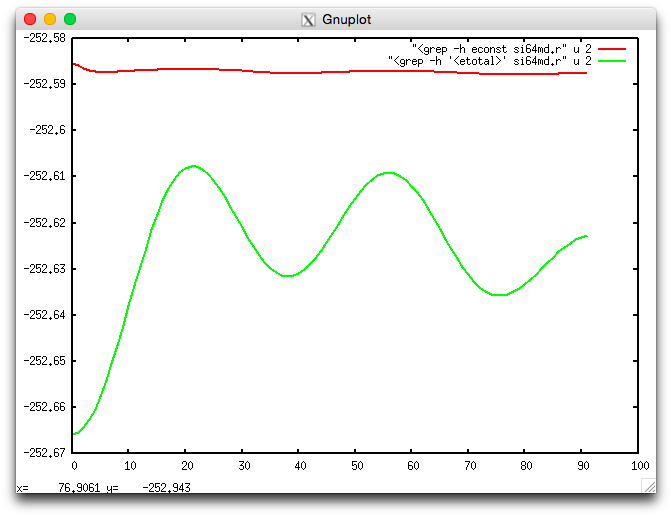

Silicon64
============

.. |si64| replace:: Si\ :sub:`64`

This example demonstrates a number of Qbox features in calculations
of the electronic structure of a 64-atom bulk silicon sample.

The example includes:

* Calculation of the ground state energy
* Structure optimization
* Molecular dynamics

.. * Calculation of empty orbitals
.. * Calculations of forces in a distorted structure
.. * Calculation of the stress tensor
.. * Structure optimization following displacement of atoms
.. * Molecular dynamics simulation
.. * Born-Oppenheimer and Car-Parrinello molecular dynamics
.. * NVT simulations with stochastic thermostats
.. * NPT simulations
.. * Constrained simulations and thermodynamic integration
.. * Maximally localized Wannier functions
.. * Electronic structure in constant electric field

Ground state energy calculation
-------------------------------
Bulk silicon has a Face-Centered Cubic (FCC) unit cell containing two 
atoms. 
An 8-atom Simple-Cubic (SC) supercell can be formed by combining 4 replicas
of the FCC primitive cell.
The |si64| sample in turn consists of 
a 2x2x2 replication of the 8-atom SC cell.

Pseudopotential
^^^^^^^^^^^^^^^
The pseudopotential used for this example is defined in the file
:download:`Si_VBC_LDA-1.0.xml`. 
This file must be present in the current directory when running the first
electronic structure calculation of the |si64| sample.

Sample definition file
^^^^^^^^^^^^^^^^^^^^^^
The sample is defined in the file
:download:`si64.i` 
where the unit cell is first defined using the :ref:`set_cmd` command and the 
:ref:`cell_var` variable, the species 'silicon' is defined using the
:ref:`species_cmd` command, and
each atom is defined using the :ref:`atom_cmd` Qbox command.

.. code-block:: none
   :caption: si64.i
   :name: si64.i

   set cell    20.52 0 0  0 20.52 0  0 0 20.52
   species silicon Si_VBC_LDA-1.0.xml
   atom Si01 silicon   -10.260000   -10.260000   -10.260000
   atom Si02 silicon    -7.695000    -7.695000    -7.695000
   atom Si03 silicon    -5.130000    -5.130000   -10.260000
   atom Si04 silicon    -2.565000    -2.565000    -7.695000
   atom Si05 silicon   -10.260000    -5.130000    -5.130000
   atom Si06 silicon    -7.695000    -2.565000    -2.565000
   atom Si07 silicon    -5.130000   -10.260000    -5.130000
   atom Si08 silicon    -2.565000    -7.695000    -2.565000
   atom Si09 silicon   -10.260000   -10.260000     0.000000
   atom Si10 silicon    -7.695000    -7.695000     2.565000
   atom Si11 silicon    -5.130000    -5.130000     0.000000
   atom Si12 silicon    -2.565000    -2.565000     2.565000
   atom Si13 silicon   -10.260000    -5.130000     5.130000
   atom Si14 silicon    -7.695000    -2.565000     7.695000
   atom Si15 silicon    -5.130000   -10.260000     5.130000
   atom Si16 silicon    -2.565000    -7.695000     7.695000
   atom Si17 silicon   -10.260000     0.000000   -10.260000
   atom Si18 silicon    -7.695000     2.565000    -7.695000
   atom Si19 silicon    -5.130000     5.130000   -10.260000
   atom Si20 silicon    -2.565000     7.695000    -7.695000
   atom Si21 silicon   -10.260000     5.130000    -5.130000
   atom Si22 silicon    -7.695000     7.695000    -2.565000
   atom Si23 silicon    -5.130000     0.000000    -5.130000
   atom Si24 silicon    -2.565000     2.565000    -2.565000
   atom Si25 silicon   -10.260000     0.000000     0.000000
   atom Si26 silicon    -7.695000     2.565000     2.565000
   atom Si27 silicon    -5.130000     5.130000     0.000000
   atom Si28 silicon    -2.565000     7.695000     2.565000
   atom Si29 silicon   -10.260000     5.130000     5.130000
   atom Si30 silicon    -7.695000     7.695000     7.695000
   atom Si31 silicon    -5.130000     0.000000     5.130000
   atom Si32 silicon    -2.565000     2.565000     7.695000
   atom Si33 silicon     0.000000   -10.260000   -10.260000
   atom Si34 silicon     2.565000    -7.695000    -7.695000
   atom Si35 silicon     5.130000    -5.130000   -10.260000
   atom Si36 silicon     7.695000    -2.565000    -7.695000
   atom Si37 silicon     0.000000    -5.130000    -5.130000
   atom Si38 silicon     2.565000    -2.565000    -2.565000
   atom Si39 silicon     5.130000   -10.260000    -5.130000
   atom Si40 silicon     7.695000    -7.695000    -2.565000
   atom Si41 silicon     0.000000   -10.260000     0.000000
   atom Si42 silicon     2.565000    -7.695000     2.565000
   atom Si43 silicon     5.130000    -5.130000     0.000000
   atom Si44 silicon     7.695000    -2.565000     2.565000
   atom Si45 silicon     0.000000    -5.130000     5.130000
   atom Si46 silicon     2.565000    -2.565000     7.695000
   atom Si47 silicon     5.130000   -10.260000     5.130000
   atom Si48 silicon     7.695000    -7.695000     7.695000
   atom Si49 silicon     0.000000     0.000000   -10.260000
   atom Si50 silicon     2.565000     2.565000    -7.695000
   atom Si51 silicon     5.130000     5.130000   -10.260000
   atom Si52 silicon     7.695000     7.695000    -7.695000
   atom Si53 silicon     0.000000     5.130000    -5.130000
   atom Si54 silicon     2.565000     7.695000    -2.565000
   atom Si55 silicon     5.130000     0.000000    -5.130000
   atom Si56 silicon     7.695000     2.565000    -2.565000
   atom Si57 silicon     0.000000     0.000000     0.000000
   atom Si58 silicon     2.565000     2.565000     2.565000
   atom Si59 silicon     5.130000     5.130000     0.000000
   atom Si60 silicon     7.695000     7.695000     2.565000
   atom Si61 silicon     0.000000     5.130000     5.130000
   atom Si62 silicon     2.565000     7.695000     7.695000
   atom Si63 silicon     5.130000     0.000000     5.130000
   atom Si64 silicon     7.695000     2.565000     7.695000

.. note::
   The size of the unit cell and the position of the atoms must be 
   specified in atomic units (bohr).

The calculation of the electronic ground state is done using the
Qbox script :download:`si64gs.i`

.. code-block:: none
   :linenos:
   :caption: si64gs.i
   :name: si64gs.i

   si64.i
   set ecut 12
   set wf_dyn PSDA
   set scf_tol 1.e-6
   randomize_wf
   run 0 30 10
   save si64gs.xml

* In line 1, the script ``si64.i`` is invoked and the contents of the 
  script are executed, defining the unit cell, the species ``silicon``
  and the position of all atoms.
* Line 2 defines the plane wave energy cutoff :ref:`ecut_var` to be 12 Ry.
  This resizes the plane wave basis set accordingly.
  Note that the unit used for the plane wave energy cutoff (Rydberg) is
  an exception to the convention used otherwise in Qbox to use 
  atomic units (Hartree and bohr).
* Line 3 defines the algorithm used to update wave functions by setting
  the variable :ref:`wf_dyn_var` to ``PSDA`` (Preconditioned Steepest Descent
  with Anderson acceleration).
* Line 4 defines the tolerance used to determine convergence in 
  self-consistent iterations (variable :ref:`scf_tol_var`).
  Iterations are considered
  converged when the energy changes by less than 10\ :sup:`-6` (hartree).
* Line 5 uses the :ref:`randomize_wf_cmd` command to add random numbers to the
  electronic wave function coefficients before starting the calculation. This
  is necessary to avoid spurious stationary points in the optimization for
  systems of high symmetry (such as bulk silicon).
* Line 6 invokes the :ref:`run_cmd` command to perform the calculation.
  The first argument (0) refers to the number of ionic steps (during which the
  atoms are moved). This is zero for the present calculation since we are only
  optimizing the electronic wave functions with fixed atoms. The second argument
  (30) is the maximum number of self-consistent iterations performed. 
  The actual number of iterations may be smaller if the convergence
  criterion :ref:`scf_tol_var` is reached before 30 iterations.
  The third argument (5) is the number of iterations used to update wave
  functions between updates of the charge density.
* Line 7 uses the :ref:`save_cmd` command to save the description 
  of the current
  system (atomic species, atomic positions and wave functions) on file
  ``si64gs.xml`` for later use in other calculations.

The calculation can be run by invoking Qbox as::

$ mpirun -np 2 qb si64gs.i > si64gs.r

Structure optimization
----------------------
This section describes an example of structure optimization.
The calculation starts from the previously saved file ``si64gs.xml``
that contains the results from the above 
electronic ground state calculation.
The atomic positions defined in the file ``si64.i`` correspond to the
equilibrium positions in the crystal. Running a structure optimization
in that structure would not show any change in the atomic positions since
the system is already in an energy minimum. For this reason, we first
impose an arbitrary displacement to two atoms. We then recompute the
electronic ground state in the displaced configuration. Finally we run
the structure optmization. We choose to displace the atom ``Si57``
(originally located at (0,0,0)) in the (1,1,1) direction. Furthermore, we
displace the atom ``Si58`` (initially located at (2.56,2.56,2.56)) in the
opposite direction. This displacement amounts to compressing the 
covalent bond between ``Si57`` and ``Si58``. We also print the 
distance between ``Si57`` and ``Si58`` before and after the displacement.

The complete procedure is included in the
Qbox script :download:`si64cg.i`

.. code-block:: none
   :linenos:
   :caption: si64cg.i
   :name: si64cg.i

   load si64gs.xml
   # print Si57-Si58 distance
   distance Si57 Si58
   # displace atoms
   move Si57 by  0.1  0.1  0.1
   move Si58 by -0.1 -0.1 -0.1
   distance Si57 Si58
   # recompute the ground state
   set wf_dyn PSDA
   set scf_tol 1.e-6
   run 0 20
   # optimize the geometry again
   set atoms_dyn CG
   run 20 20

* In line 1, the sample restart file saved in the previous ground
  state calculation is loaded using the :ref:`load_cmd` command. 
  Note that it is not necessary to perform the ground state calculation
  as a separate run. The contents of the file ``si64gs.i`` could be
  included to replace line 1 if a single run is desired.
* Line 3 computes and prints the distance between atoms ``Si57`` and ``Si58``
  in their original equilibrium positions.
* Lines 5 and 6 use the :ref:`move_cmd` command to displace the atoms
  ``Si57`` and ``Si58`` using relative displacements.
* Line 7: The distance is printed again after the displacement.
* Lines 9-11: The electronic ground state is recomputed in the displaced
  configuration.
* Line 13: The Conjugate Gradient (CG) algorithm is chosen for the atomic
  motions during the structure optimization (variable :ref:`atoms_dyn_var`).
* Line 14: Run 20 steps of CG optimization with up to 20 self-consistent 
  iterations after each CG step.

The structure optimization can be run using e.g. the command::

$ mpirun -np 2 qb si64cg.i > si64cg.r

This calculation results in the structure relaxing back to its original 
geometry. The position of the ``Si57`` atom can be monitored using the
following ``xml_grep`` command::

$ xml_grep 'atom[@name="Si57"]' sicg64.r

Note the use of XPath syntax for the selection of the contents. If we only 
want to extract the ``<position>`` element of this atom, we can use::

$ xml_grep 'atom[@name="Si57"]/position' sicg64.r

which results in the output

.. code-block:: xml

   <?xml version="1.0" ?>
   <xml_grep version="0.9" date="Wed Sep 19 10:56:30 2018">
   <file filename="si64cg.r">
   <position> 0.10000000 0.10000000 0.10000000 </position>
   <position> 0.10000000 0.10000000 0.10000000 </position>
   <position> 0.07091875 0.07091496 0.07091517 </position>
   <position> 0.03892938 0.03892141 0.03892186 </position>
   <position> 0.03272656 0.03272011 0.03272313 </position>
   <position> 0.02590347 0.02589868 0.02590453 </position>
   <position> 0.01315803 0.01315262 0.01315769 </position>
   <position> 0.00971123 0.00970692 0.00971360 </position>
   <position> 0.00591369 0.00590986 0.00591650 </position>
   <position> 0.00437996 0.00437665 0.00438359 </position>
   <position> 0.00304774 0.00304471 0.00305234 </position>
   <position> 0.00230019 0.00229737 0.00230545 </position>
   <position> 0.00175876 0.00175604 0.00176424 </position>
   <position> 0.00148228 0.00147959 0.00148851 </position>
   <position> 0.00115785 0.00115514 0.00116439 </position>
   <position> 0.00099169 0.00098897 0.00099865 </position>
   <position> 0.00090564 0.00090294 0.00091274 </position>
   <position> 0.00077748 0.00077469 0.00078462 </position>
   <position> 0.00072244 0.00071967 0.00072987 </position>
   <position> 0.00061519 0.00061231 0.00062260 </position>
   <position> 0.00058607 0.00058320 0.00059378 </position>
   </file>
   </xml_grep>

Similarly, the evolution of the force on atom ``Si57`` can be extracted
using::

$ xml_grep 'atom[@name="Si57"]/force' si64cg.r

The distance between ``Si57`` and ``Si58`` can be extracted using one of
the Qbox utility scripts (in the ``util`` directory)::

$ qbox_distance.py Si57 Si58 si64cg.r 

This shows that the distance has relaxed to the value 4.441 (bohr), close to
the original equilibrium distance of 4.443 (bohr).

Molecular dynamics
------------------
In this example, we demonstrate a molecular dynamics simulation. We start
from the previously computed electronic ground state saved in the 
restart file ``si64gs.xml``. Rather than imposing arbitrary displacement
on atoms, we set the initial atomic velocities to be randomly sampled
from a Maxwell-Boltzmann distribution at a temperature of 300 K.
We then choose Molecular Dynamics (MD) as the 
algorithm for atomic motions. A time step must also be chosen for the 
numerical integration of the Newton equations of motion. 

The complete MD simulation is included in the
Qbox script :download:`si64md.i`

.. code-block:: none
   :linenos:
   :caption: si64md.i
   :name: si64md.i

   load si64gs.xml
   # randomize velocities
   randomize_v 300
   set scf_tol 1.e-6
   # run 100 MD steps
   set dt 40
   set atoms_dyn MD
   run 100 20

* In line 1, the sample restart file saved in the previous ground
  state calculation is loaded using the :ref:`load_cmd` command. 
* In line 3, the atomic velocities are randomized using the 
  :ref:`randomize_v_cmd` command. The argument (300) is the temperature
  of the Maxwell-Boltzmann distribution from which velocities are drawn.
* Line 4 defines the tolerance used for the convergence of the self-consistent
  iterations.
* Line 5: A time step of 40 (a.u.) (approximately 0.968 fs) is chosen for
  the integration of the atomic equations of motion.
* Line 6: The Molecular Dynamics (MD) algorithm is chosen for the atomic
  motions during the simulation. This uses the Verlet algorithm to update
  atomic positions at each time step.
* Line 7: Run 100 MD steps, with up to 20 self-consistent iterations after
  after each step.

The MD simulation can be run using e.g. the command::

$ mpirun -np 2 qb si64md.i > si64md.r

Once the simulation is completed, the evolution of the Kohn-Sham energy 
and the quality of energy conservation can be visualized using::

$ econste.plt si64md.r

resulting in the following image

.. _fig_si64md_econste:

   Kohn-Sham energy <etotal> (green) and constant of the motion 
   <econst> (red) during the molecular dynamics simulation.

This shows that the constant of the motion <econst> is reasonably constant
on the scale of the fluctuations of <etotal>. 
