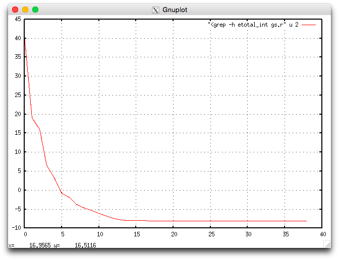
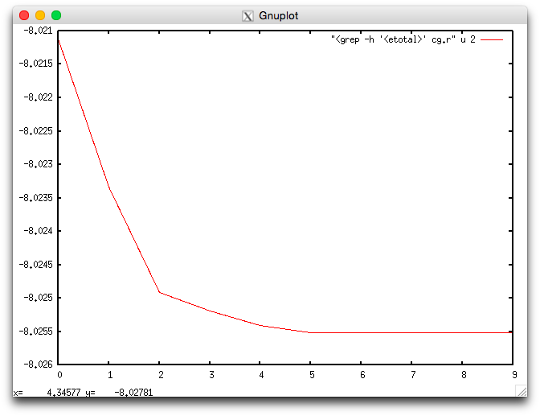
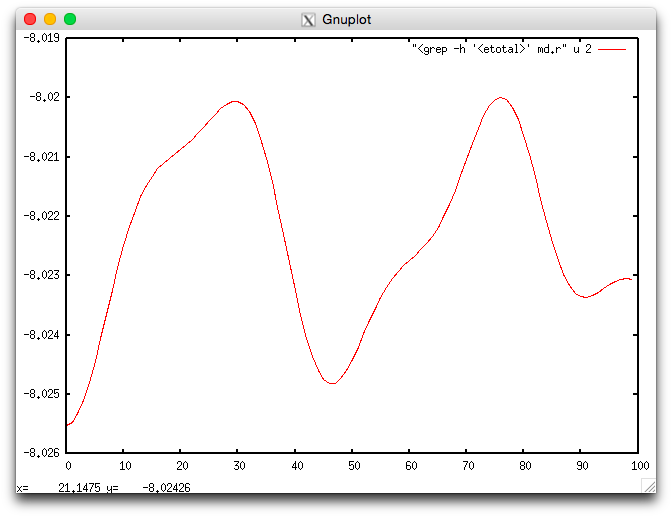
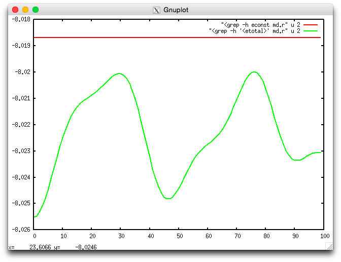
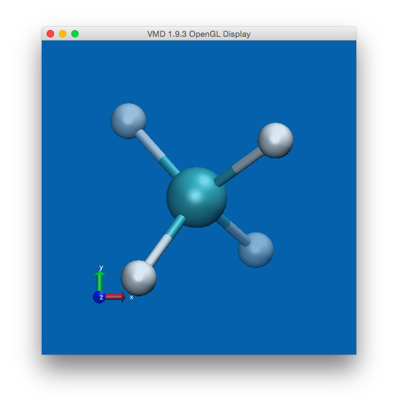

Introduction
============

Qbox is a First-Principles Molecular Dynamics code. It can be used to compute
the electronic structure of atoms, molecules, solids and liquids within the
Density Functional Theory (DFT) formalism. It can also be used to perform
first-principles molecular dynamics (FPMD) simulations using forces computed
within DFT. Qbox computes the solutions of the Kohn-Sham equations using a
plane wave basis set and norm-conserving pseudopotentials. Notable 
Qbox features include:

* DFT-GGA and hybrid DFT electronic structure
* Born-Oppenheimer and Car-Parrinello molecular dynamics
* NVT simulations with stochastic thermostats
* NPT simulations
* Constrained simulations and thermodynamic integration
* Maximally localized Wannier functions
* Electronic structure in constant electric field
* Use as a DFT engine in client-server coupling to other software

Basic Operation
===============

Qbox reads input from standard input and writes output to standard output.
It can be used either interactively or in batch mode.

.. _cmd_line_options:

Command line options
--------------------
A set of command line options can be used
when invoking Qbox to optimize the distribution of computations among MPI tasks.
The ``-nstb`` (number of state blocks), ``-nkpb`` (number of k-point blocks)
and ``-nspb`` (number of spin blocks) command line options are used
to partition MPI tasks into a four-dimensional
communicator of dimensions ``ngb x nstb x nkpb x nspb``. The ``ngb``
value (number of G vector blocks) is inferred from the total number
of tasks and the values of the three other parameters. Slater determinants
(represented by the Fourier coefficients of all states) are
distributed over rectangular process grids of size ``ngb x nstb``.
Slater determinants indexed by different k-points are distributed among
``nkpb`` blocks of size ``ngb x nstb``.
Slater determinants of different spin indices are
distributed among ``nspb`` blocks of size ``ngb x nstb x nkpb``.
The dimensions of the communicator are printed on output. For example,
invoking Qbox with a total of 240 tasks and using the following arguments::

$ qb -nstb 2 -nkpb 5 -nspb 2

results in the following output::

 MPIdata::comm 12x2x5x2

Slater determinants are represented on rectangular 12x2 process grids. There
are 5 such process grids for each of the 2 spin components of the
wave functions.

The default value of ``nstb``, ``nkpb`` and ``nspb`` is 1. The ``nspb`` value
can only be 1 or 2.

Interactive mode
----------------
In interactive mode, Qbox is started by invoking the executable name::

$ qb

For parallel operation, the executable must be invoked using 
the mpirun command (shown here for 4 parallel tasks)::

$ mpirun -np 4 qb

Qbox first prints information about the code release number and number
of tasks, followed by the command prompt::

[qbox]

Qbox then expects the user to type a command. Each command is processed
sequentially and 
output is printed to standard output (i.e the screen), until the ``quit``
command is entered.

Batch mode
----------

In batch mode, Qbox reads commands from an input file and writes output to 
an output file.
This can be done using the conventional Unix redirection mechanism::

$ qb < file.i > file.r

or::

$ mpirun -np 4 qb < file.i > file.r

The convention used here for filename extensions is ``.i`` for "input" and
``.r`` for "results". Any other file naming scheme can be used.
On some computers, input redirection is not fully supported. 
For that reason, Qbox can also read input from an input file given as 
an argument on the command line::

$ qb file.i > file.r

or::

$ mpirun -np 4 file.i > file.r

Qbox input 
----------

Qbox input consists of a sequence of Qbox commands. The complete 
list of Qbox commands is detailed in the :ref:`cmd_index` Section.
If a command is read on input and is not in the above list, Qbox interprets it
as the name of an input script and attempts to open a file having that name in
the current working directory. If the file can be opened and is readable, Qbox
starts interpreting each line of that file as its input. Qbox scripts can be
nested. At the end of a script, Qbox returns to the previous script level and
continues to read commands. At the end of the topmost level script, Qbox exits.
Unix commands can be issued within a Qbox input sequence using a shell escape
“!” character at the beginning of a line. For example, the line::

 [qbox] !date

invokes the Unix date command.  Comments can be inserted in Qbox input by
inserting a '#' character at the beginning of each comment line::

 [qbox] # print the list of all atoms
 [qbox] list_atoms

Comments can also be added at the end of a command line by inserting a “#”
character where the comment starts::

[qbox] list_atoms # get a list of all atoms

Calculation parameters such as the plane wave energy cutoff are specified using
Qbox variables. Qbox variables can be set using the :ref:`set_cmd` command.
Their value can be printed using the :ref:`print_cmd` command. 
For example the command:

.. code-block:: none

   set ecut 24

sets the variable :ref:`ecut_var` to the value 24. This causes the plane wave
basis set to be resized to include all plane waves with a kinetic energy not
exceeding 24 Rydberg. Other Qbox variables can be set similarly. 
Qbox variables have a default value. Some variables take multiple values
(e.g. :ref:`cell_var`). A complete list of Qbox variables is given in
the :ref:`var_index` Section.

A simple example
----------------

.. |ch4| replace:: CH\ :sub:`4`

As a simple example illustrating the structure of a Qbox input script, we
consider the calculation of the energy of a methane molecule (|ch4|).
followed by a geometry optimization and a molecular dynamics run.

Ground state calculation
^^^^^^^^^^^^^^^^^^^^^^^^

The complete input file for the calculation of the ground state is:

.. code-block:: none
   :linenos:
   :caption: gs.i
   :name: gs.i

   # CH4 ground state
   species carbon   C_HSCV_PBE-1.0.xml
   species hydrogen H_HSCV_PBE-1.0.xml
   atom C    carbon       0.00000000   0.00000000   0.00000000
   atom H1   hydrogen     1.25000000   1.25000000   1.25000000
   atom H2   hydrogen     1.25000000  -1.25000000  -1.25000000
   atom H3   hydrogen    -1.25000000   1.25000000  -1.25000000
   atom H4   hydrogen    -1.25000000  -1.25000000   1.25000000
   set cell 15 0 0  0 15 0  0 0 15
   set ecut 35
   set wf_dyn PSDA
   set xc PBE
   set scf_tol 1.e-8
   randomize_wf
   run 0 200
   save gs.xml

We now analyze in detail the input script:

* In lines 2 and 3, the :ref:`species_cmd` command is used to 
  define two new species
  (carbon and hydrogen) in the simulation. This assumes that the files
  ``C_HSCV_PBE-1.0.xml`` and ``H_HSCV_PBE-1.0.xml`` are present in the current
  working directory. These files contain the definition of pseudopotentials that
  describe the electron-ion interaction for carbon and hydrogen respectively.
* Lines 4-8 use the :ref:`atom_cmd` command to define 
  new atoms at their respective
  positions (bohr) and give them appropriate names.
* Line 9 defines the dimensions of the unit cell by setting the value 
  of the :ref:`cell_var` variable (bohr).
  The unit cell is a cube of side 15 (bohr).
* Line 10 sets the value of the plane wave energy cutoff (variable
  :ref:`ecut_var`) to 35 Ry, which resizes the plane wave basis accordingly.
* Line 11 defines the algorithm used to update wave functions by setting
  the variable :ref:`wf_dyn_var` to ``PSDA`` (Preconditioned Steepest Descent
  with Anderson acceleration).
* Line 12 sets the :ref:`xc_var` variable to ``PBE`` to select the PBE
  exchange-correlation functional.
* Line 13 defines the tolerance used to determine convergence in 
  self-consistent iterations (variable :ref:`scf_tol_var`).
  Iterations are considered
  converged when the energy changes by less than 10\ :sup:`-8` (hartree).
* Line 14 uses the :ref:`randomize_wf_cmd` command to add random numbers to the
  electronic wave function coefficients before starting the calculation. This
  is necessary to avoid spurious stationary points in the optimization for
  systems of high symmetry (such as |ch4|).
* Line 15 invokes the :ref:`run_cmd` command to perform the calculation.
  The first argument (0) refers to the number of ionic steps (during which the
  atoms are moved). This is zero for the present calculation since we are only
  computing the electronic wave functions with fixed atoms. The second argument
  (200) is the maximum number of self-consistent iterations performed. 
  The actual number of iterations may be smaller if the convergence
  criterion :ref:`scf_tol_var` is reached before 200 iterations.
* Line 16 uses the :ref:`save_cmd` command to save the description 
  of the current
  system (atomic species, atomic positions and wave functions) on file
  ``gs.xml`` for later use in other calculations.

The calculation can be run by invoking Qbox as::

 $ mpirun -np 2 qb gs.i > gs.r

The Qbox output file ``gs.r`` generated by this calculation is an XML 
document that contains a mix of readable text and XML elements. 
This facilitates the extraction of
computed quantities from the output file using XML tools.
For example, the ``<etotal>`` element contains the energy of the system 
(expressed in hartree units) at the
end of the self-consistent calculation. It can be extracted using 
e.g. the ``xmllint`` program (version >20900) as follows::

 $ xmllint --xpath '//etotal' gs.r
 <etotal>      -8.02111902 </etotal>

Another common XML tool is the ``xml_grep`` program distributed as part of the
Perl Twig distribution:

.. code-block:: xml

 $ xml_grep etotal gs.r

 <?xml version="1.0" ?>
 <xml_grep version="0.9" date="Tue Jul 24 19:34:38 2018">
 <file filename="gs.r">
   <etotal>      -8.02111902 </etotal>
 </file>
 </xml_grep>

Finally, the Unix ``grep`` command can also be used on the ``'<etotal>'`` 
expression

.. code-block:: xml

 $ grep '<etotal>' gs.r
  <etotal>      -8.02111902 </etotal>

Using ``grep`` retrieves the lines containing the ``'<etotal>'`` string.
This will include the value of ``<etotal>`` in this case, but does not work
for elements that span multiple lines.

A number of plot scripts are provided in the ``util`` directory of the Qbox
distribution. For example, invoking the ``etotal_int.plt`` script::

 $ etotal_int.plt gs.r

will extract the intermediate values of the energy during self-consistent 
iterations (element ``<etotal_int>``) and generate a plot using the 
``gnuplot`` program:

.. _fig_etotal_int:

   Intermediate energy <etotal_int> during 
   self-consistent iterations.

This allows for a quick inspection of the convergence of the calculation.

.. note:: 

   The gnuplot program is not provided with Qbox and must be installed
   separately.

Larger XML fragments such as the ``<atomset>`` element can be extracted from 
output files using ``xml_grep``:

.. code-block:: xml

 $ xml_grep atomset gs.r

  <?xml version="1.0" ?>
  <xml_grep version="0.9" date="Thu Jul 26 15:42:21 2018">
  <file filename="gs.r">
    <atomset>
      <unit_cell a=" 15.00000000   0.00000000   0.00000000" b="  0.00000000  15.00000000   0.00000000" c="  0.00000000   0.00000000  15.00000000"/>
      <atom name="C" species="carbon">
        <position> 0.00000000 0.00000000 0.00000000 </position>
        <velocity> 0.00000000 0.00000000 0.00000000 </velocity>
        <force> -0.00000095 -0.00000463 -0.00000191 </force>
      </atom>
      <atom name="H1" species="hydrogen">
        <position> 1.25000000 1.25000000 1.25000000 </position>
        <velocity> 0.00000000 0.00000000 0.00000000 </velocity>
        <force> -0.01459937 -0.01459776 -0.01459803 </force>
      </atom>
      <atom name="H2" species="hydrogen">
        <position> 1.25000000 -1.25000000 -1.25000000 </position>
        <velocity> 0.00000000 0.00000000 0.00000000 </velocity>
        <force> -0.01460360 0.01460308 0.01460326 </force>
      </atom>
      <atom name="H3" species="hydrogen">
        <position> -1.25000000 1.25000000 -1.25000000 </position>
        <velocity> 0.00000000 0.00000000 0.00000000 </velocity>
        <force> 0.01460679 -0.01460536 0.01460398 </force>
      </atom>
      <atom name="H4" species="hydrogen">
        <position> -1.25000000 -1.25000000 1.25000000 </position>
        <velocity> 0.00000000 0.00000000 0.00000000 </velocity>
        <force> 0.01460517 0.01460393 -0.01460412 </force>
      </atom>
    </atomset>
  </file>
  </xml_grep>

The above calculation of the electronic ground state used 
approximate atomic coordinates based on a reasonable guess of the
structure of the |ch4| molecule. A natural next step is to optimize
the molecule geometry to find its minimum energy structure.

Geometry optimization
^^^^^^^^^^^^^^^^^^^^^
The complete input file for the geometry optimization of |ch4| is:

.. code-block:: none
   :linenos:
   :caption: cg.i
   :name: cg.i

   # CH4 structure optimization
   load gs.xml
   set wf_dyn PSDA
   set xc PBE
   set scf_tol 1.e-8
   set atoms_dyn CG
   run 10 10
   save cg.xml

We now analyze in detail the input script:

* In line 2, the :ref:`load_cmd` command reads the description of the sample
  previously saved in the file ``gs.xml`` at the end of the ground state 
  calculation.
* Lines 3-5 set the :ref:`wf_dyn_var`, :ref:`xc_var`, 
  and :ref:`scf_tol_var` variables as in the ground state calculation.
* Line 6 selects the algorithm used to move atoms as CG for "conjugate
  gradient).
* Line 7 invokes the :ref:`run_cmd` command to perform the calculation, 
  with 10 ionic
  steps (where atoms are moved) and 10 self-consistent iterations before 
  each move of the atoms.
* Line 8 uses the :ref:`save_cmd` command to write the description 
  of the sample to
  the file ``cg.xml`` for later use in another calculation.

The evolution of the energy during the geometry optimization can be visualized
using the ``etotal.plt`` script:

.. _fig_etotal:

   Energy <etotal> during the geometry optimization.

Numerical values of <etotal> can be extracted using ``xml_grep``:

.. code-block:: none

  $ xml_grep etotal cg.r
  <?xml version="1.0" ?>
  <xml_grep version="0.9" date="Fri Jul 27 16:58:40 2018">
  <file filename="cg.r">
    <etotal>      -8.02111902 </etotal>
    <etotal>      -8.02333130 </etotal>
    <etotal>      -8.02491158 </etotal>
    <etotal>      -8.02519366 </etotal>
    <etotal>      -8.02540308 </etotal>
    <etotal>      -8.02550918 </etotal>
    <etotal>      -8.02550995 </etotal>
    <etotal>      -8.02551261 </etotal>
    <etotal>      -8.02551265 </etotal>
    <etotal>      -8.02551269 </etotal>
  </file>
  </xml_grep>

Molecular dynamics
^^^^^^^^^^^^^^^^^^
We now demonstrate the use of Qbox in a short Born-Oppenheimer molecular
dynamics simulation. The simulation consists of 100 MD steps, with a time
step of 10 (a.u.). Atomic velocities are initialized with random values from
a Maxwell-Boltzmann distribution at a temperature of 400 K.

The complete input file for the molecular dynamics simulation of |ch4| is:

.. code-block:: none
   :linenos:
   :caption: md.i
   :name: md.i

   # CH4 molecular dynamics simulation
   load cg.xml
   set wf_dyn PSDA
   set xc PBE
   set scf_tol 1.e-6
   set dt 10
   set atoms_dyn MD
   randomize_v 400
   run 100 10
   save md.xml

We now analyze in detail the input script:

* In line 2, the :ref:`load_cmd` command reads the description of the sample
  previously saved in the file ``cg.xml`` at the end of the geometry 
  optimization.
* Lines 3-5 set the :ref:`wf_dyn_var`, :ref:`xc_var`, 
  and :ref:`scf_tol_var` variables as in the ground state and 
  geometry optimization calculations.
* Line 6 sets the variable :ref:`dt_var` (time step) to 10 (a.u.). 
  1 (a.u.) = 0.02418885 fs.
* Line 7 selects the algorithm used to move atoms as MD (molecular dynamics).
* Line 8 uses the :ref:`randomize_v_cmd` command to initialize atomic 
  velocities with
  random numbers drawn from a Maxwell-Boltzmann distribution at T=400 K.
* Line 9 invokes the :ref:`run_cmd` command to perform the calculation. The 
  simulation consists of 100 ionic steps, with 10 self-consistent iterations
  before each step. 
* Line 10 uses the :ref:`save_cmd` command to write the 
  description of the sample to
  the file ``md.xml`` for later use in another calculation.

The evolution of the energy during the simulation can be visualized using
the ``etotal.plt`` script:

.. _fig_etotal_md:

   Energy <etotal> during the molecular dynamics simulation.

The quality of the simulation can be monitored by visualizing the energy 
together with the constant of the motion (element ``<econst>``):

  .. math::

     E_{\rm const} = E_{\rm KS} + T_{\rm ion}

where :math:`E_{\rm KS}` is the (Kohn-Sham) energy, represented by the value
of the element ``<etotal>`` and :math:`T_{\rm ion}` is the kinetic energy
of the ions. The script ``econste.plt`` shows the value of both ``<etotal>``
and ``<econst>``:

.. _fig_econst_md:

   Energy <etotal> and constant of the motion <econst> during the MD simulation.

The quantity ``<econst>`` shows no appreciable variation on the scale of the 
variation of ``<etotal>``, confirming the validity of the approximations
used in the simulation. Inaccurate calculations of the electronic ground
state between MD steps (due e.g. to an insufficient number of self-consistent
iterations) typically lead to a sizeable drift in the value of ``<econst>``.
Similarly, oscillations in ``<econst>`` may be observed if the value of the 
time step :ref:`dt_var` is too large.

The atomic trajectories can be visualized by generating an "xyz" file 
containing the atomic positions at each step of the simulation, and using
a visualization program such as VMD. The xyz file can be generated using the 
``qbox_xyz.py`` script::

$ qbox_xyz.py md.r > md.xyz

Rendering the file ``md.xyz`` with VMD allows for visual inspection of the 
trajectories using the VMD graphical user interface:

.. _fig_vmd_md:

   Visualization of the |ch4| molecule using the VMD program.

